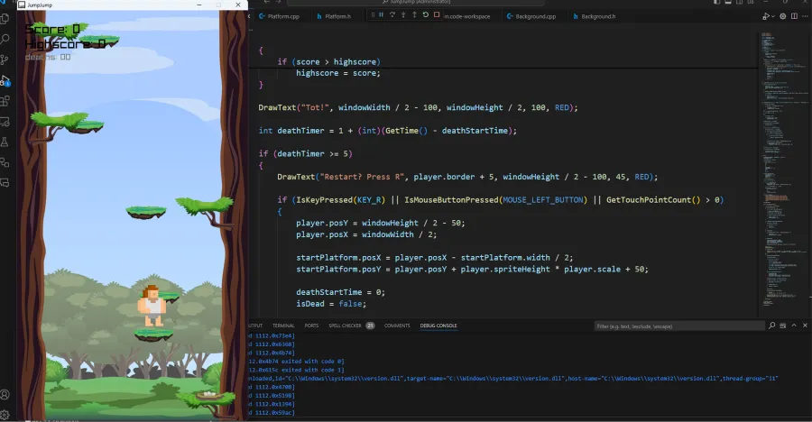

# JumpJump

**JumpJump war mein erstes eigenes Projekt.** Ich habe das Spiel mit C++ und raylib entwickelt, um die Inhalte aus meinem C++-Grundlagenkurs praktisch anzuwenden und zu üben.

Mir war wichtig, das Gelernte in einem eigenen kleinen Spiel zusammenzubringen – von der Bewegung der Spielfigur bis zur Kollision mit den Plattformen.

## Vorschau

## Das Spiel

In JumpJump springst du von Plattform zu Plattform und versuchst, möglichst weit nach oben zu kommen. Dabei musst du deine Sprünge richtig timen und die Spielfigur auf den Plattformen landen lassen. Score und Highscore zeigen deinen Fortschritt an.

🎮 **[JumpJump direkt im Browser spielen](https://jumpjump.nicoegerer.de/)**

Für die Browser-Version ist keine Installation nötig.

## Steuerung

| Taste | Aktion |
| --- | --- |
| A / D | Nach links / rechts bewegen |
| Leertaste | Springen |
| R | Nach dem Game Over neu starten, sobald die Aufforderung erscheint |

## Was ich dabei geübt habe

- C++-Klassen für Spielfigur, Plattformen und Hintergrund
- Eine Spielschleife mit Eingaben, Aktualisierung und Darstellung
- Bewegung, Sprünge und Kollisionserkennung
- Sprite-Animationen, Hintergründe und Soundeffekte

## Vom Desktop ins Web

Ursprünglich habe ich JumpJump als Desktop-Spiel mit **C++ und raylib** entwickelt. Weil ich es auch im Web spielbar machen wollte, habe ich es anschließend zu **WebAssembly** kompiliert.

So lässt sich das C++-Spiel direkt im Browser ausprobieren. Die fertige Web-Version liegt im Ordner [Web](Web).

**Technologien:** C++ · raylib · WebAssembly
